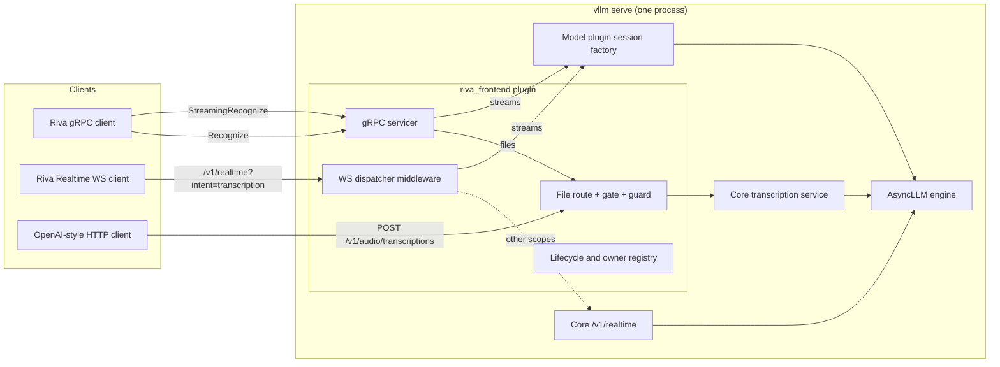

# vllm-riva-frontend on vLLM core: high-level design

## Problem

Clients written for NVIDIA Riva and Speech NIM (Riva gRPC, the Riva Realtime WebSocket, NIM HTTP)
should be able to use an ASR model served by vLLM without changes to the client. This frontend
translates those dialects to vLLM. It ran as an application plugin on vLLM-Omni; this design moves
it onto vLLM core as an endpoint plugin, so that one `vllm serve` process with two installed plugins
(this frontend and a streaming model plugin) serves every surface.

## Approach

1. **An RFC 2 endpoint plugin.** The frontend is one `EndpointPlugin` (`RivaFrontendPlugin`, name
   `riva_frontend`) in the `vllm.endpoint_plugins` group, declaring `required_tasks = ("realtime",)`
   and `owns_non_http_listener = True` (so the server runs one API process). Core calls its
   lifecycle methods: `attach_router` (HTTP routes and the WebSocket dispatcher), `init_state`
   (configuration, model checks, session factory), `start` (the gRPC listener), `ready`, `drain` and
   `stop`.
2. **Streams through the model's session factory.** Live streams (Riva `StreamingRecognize`, the
   Riva Realtime WebSocket) run on a session factory that the model plugin publishes. The factory
   is discovered by entry point and used through a structural protocol: neither package imports
   the other.
3. **Complete files through core.** Riva `Recognize` and `POST /v1/audio/transcriptions` both run
   on core's transcription service on the same server, behind one frontend-owned in-flight file
   gate and request guard.

## Target users

- Operators who run Riva or Speech NIM clients and want vLLM as the server.
- vLLM maintainers reviewing RFC 2, for whom this is a reference consumer of the endpoint plugin
  lifecycle.

## Goals

1. A stock Riva client (`nvidia-riva/python-clients`) streams, recognizes complete files and lists
   models against `vllm serve`, unmodified.
2. The Riva Realtime WebSocket dialect keeps its contract.
3. One server, one engine: no second inference engine, no sidecar.
4. Every task the frontend starts has an owner until it ends; shutdown is bounded by one deadline.

## Non-goals

- A Speech NIM HTTP response shape for complete files: clients get core's OpenAI transcription
  response.
- Per-utterance finals on streams (endpointing): deferred, to be designed with the model plugin.
- Serving models other than those whose plugin publishes a session factory.
- Changing vLLM core beyond RFC 1 and RFC 2.

## Tenets

- **Core's serving services over dialect re-implementation.** Where a core service satisfies a
  surface's contract (complete-file transcription), the frontend routes to it and adapts protocol
  differences at the boundary, accepting dialect changes that do not break that contract (the NIM
  HTTP response becomes OpenAI's shape). It implements only what core lacks (Riva gRPC, the Riva
  Realtime WebSocket framing). The tenet never overrides the stock Riva gRPC contract or the Riva
  Realtime WebSocket contract, which are constraints.
- **Streams before files** (from the model plugin): when stream and file service compete, the
  choice favours streams; the file gate exists for that.

## System design

| Component | Role |
| --- | --- |
| Lifecycle (`RivaFrontendPlugin`) | Reads configuration from `--additional-config` (key `riva_frontend`), checks the served model's tasks, resolves the session factory, owns the registry of transport owner tasks, runs `drain` and `stop`, escalates faults |
| gRPC servicer | `StreamingRecognize`, `Recognize`, `GetRivaSpeechRecognitionConfig`, health, reflection, on the frontend's own listener |
| WebSocket dispatcher | Middleware added in `attach_router`; claims a WebSocket scope only for path `/v1/realtime` with query exactly `intent=transcription`; every other scope passes to core unchanged |
| File route | Replaces core's `POST /v1/audio/transcriptions` through RFC 2's route override; applies the ingress cap, file gate and guard, then calls core's transcription service |
| Realtime bootstrap | `POST /v1/realtime/transcription_sessions`, returning the session defaults the WebSocket dialect echoes |
| Audio frontend | Decode and resample to 16 kHz mono `float32` (μ-law, A-law, PCM16, RIFF/WAV) |
| Error catalog | One mapping from frontend and seam failures to Riva gRPC status codes and NIM WebSocket error codes |
| Operational routes | NIM `/v1/health/ready`, `/v1/health/live`, `/v1/version`, `/v1/metadata` as HTTP routes |

### Session-factory seam

- **Discovery.** Entry-point group `vllm_riva_frontend.session_factories`, owned and documented
  here. `init_state` calls each factory constructor with `(engine_client, engine_client.model_config)`
  unchanged; a constructor returns `None` when it does not serve the model. Exactly one factory must
  accept, unless the configuration names one. A constructor that raises fails startup; that raise is
  the frontend's only engine-capability check.
- **Protocol** (as published by the model plugin's session design): the factory exposes
  `served_cadences`, `locales`, `default_locale` (possibly `None`), `open(cadence, locale)`,
  `drain(deadline) -> list` of cleanup faults (absolute `time.monotonic()` deadline) and
  `teardown_all() -> set` of tasks; a lease exposes `feed`, `update_locale` (returns `None`), `flush`
  (returns the final transcript), `finish`, `abort`, `release` and synchronous `teardown`.
- **Cadence and locale.** Streaming surfaces open at `560ms`; `init_state` fails if the factory does
  not serve it. A stream's locale is the client's, validated against `locales`; when the client
  names none, `default_locale`; when that is `None`, the client must name one.
- **Error contract.** Seam exceptions carry `session_error` (`refused` or `failed`) and `reason`;
  the error catalog maps each reason on its own (for example `locale` is the client's bad input,
  `capacity` and `active_limit` are load, `expired` is an idle stream the engine ended), never all
  refusals to capacity.

### Lifecycle

- **Owners.** The frontend owns one registry of transport owner tasks (one per gRPC stream,
  WebSocket session or file request); the factory owns every engine-facing task of its sessions.
  No detached tasks: a cancelled call settles before abort and release run.
- **Bounded ingress.** A finite ingress cap admits a connection's owner before any configuration or
  audio is read; reads and waits are bounded in time; a client disconnect releases what it held.
  This cap bounds frontend memory and work; the file gate (below) separately bounds files in
  inference.
- **Bounds.** Every lease call runs under a finite frontend bound (configuration, first audio,
  idle, finalization, cleanup). `init_state` reads the engine's stream deadlines (the
  `stream_admission` settings: never-fed, parked-idle and draining) and fails startup unless each
  frontend bound is below the matching engine deadline, so the frontend's bounds are below the engine's
  and the engine's idle abort (`expired`, reported as an idle timeout) is a backstop. The engine
  is the authority for sub-unit traffic and the frontend suspends client-idle timing while a
  lease call is outstanding, so the engine can still end a stream first. During `drain`,
  every bound is the remaining time to one absolute deadline.
- **`drain(state, timeout)`.** Health `NOT_SERVING`; close admission; let owners finish until a
  settle point; then each remaining stream's owner finalizes it (the client gets its final after
  release) or, if that cannot finish, cleans it up as the session design prescribes (abort an open
  lease, never a flushed one, then release), all within the deadline; stop the gRPC server with
  the remaining grace; then `factory.drain(...)`, logging the faults it returns. The plugin finishes
  early enough to leave core time to shut the engine down.
- **`stop(state)`.** Terminal and prompt: mark torn down, `factory.teardown_all()`, cancel owners,
  stop the listener, one short bounded wait for cancellation delivery; no awaited engine work.
- **Faults.** A frontend task collects factory cleanup faults while serving (calling the factory's
  `drain` with an immediate deadline, serialized with the shutdown `drain`), and a listener monitor
  watches the gRPC server. An `engine_dead` failure from any call, a collected fault, or an
  unexpected listener exit withdraws readiness and calls `state.request_shutdown()` (an orderly
  restart, not a latch). `stop` also cancels the collector and the monitor. `ready` reads attributes
  only.

### Complete files

- **One gate.** A counting gate of `max_concurrent_files` covers `Recognize` and the HTTP route. It
  caps files in flight; it does not reserve capacity for streams (a finished file's slot is held
  until it retires). `init_state` fails unless the cap is below both the state-slot count and the
  engine's active-request limit; when that capacity is below 2 and no cap is configured, files are
  disabled with a warning instead (`Recognize` answers `UNIMPLEMENTED`, no `offline` listing, and
  the frontend's route refuses with 501).
- **HTTP route.** The frontend's route replaces core's `POST /v1/audio/transcriptions`. After the
  ingress cap admits it, it reads the request body into memory up to a configured bound (larger
  bodies get 413), parses the multipart form in memory with the frontend's bounded parser (no
  filesystem), applies core's upload limit (`VLLM_MAX_AUDIO_CLIP_FILESIZE_MB`) to the file part as
  core's route would, refuses `use_beam_search` and completion limits with 400, takes a gate permit,
  and calls core's transcription service with the audio bytes and a request built with an in-memory
  upload. It returns core's response or event stream as core's route does, keeps core's server-load
  accounting, and on client disconnect cancels the core request and releases the permit. The permit
  is held until the response body has been sent. `init_state` checks that the body bound covers
  core's upload limit. The service is core's internal serving class, which RFC 2 documents as not yet
  a stable contract; the frontend pins it with tests.
- **`Recognize`.** Converts the request's audio to an in-memory 16 kHz mono 16-bit WAV and calls the
  same service through the same gate.
- **Locale.** For `Recognize`, the client's locale is validated against the factory's `locales` and
  sent exactly as `vllm_xargs={"locale": ...}`; `language` carries the locale's language only when
  it is in the model's `supported_languages`, else `None` (also for `auto`). Languages core does not
  know remain reachable this way. The HTTP route keeps core's contract: it forwards the client's
  `language` unchanged, for the model to map, and accepts a client `vllm_xargs` whose only key is
  `locale`. Defaults follow the factory's `default_locale`, on every surface and in the
  realtime bootstrap response; when it is `None`, the client must name a locale.
- **Capability.** `Recognize` and the HTTP route need the model's `transcription` task. Core
  attaches its transcription route only for such a model, so `attach_router` replaces the route only
  when core's `POST /v1/audio/transcriptions` is present (`/v1/audio/translations` stays core's,
  and the model refuses translation); without the task, `Recognize` answers
  `UNIMPLEMENTED`. `GetRivaSpeechRecognitionConfig` lists the model once per served locale with
  `type=online` and, when complete files are served, again per locale with `type=offline`; each
  entry names its `language_code` and the encodings and rates it accepts. Unsupported request features are refused explicitly, never ignored.

## Constraints

- **Engine.** vLLM with RFC 1 (persistent-state primitive, stream admission) and RFC 2 (endpoint
  plugin lifecycle); the current target is their merge, `rfc12-integration-v2` on `pdtgct/vllm`. The engine-client protocol
  does not declare the stream-admission calls; the model plugin's factory checks for them.
- **Plugins.** `VLLM_PLUGINS=riva_frontend,nemotron_asr_streaming` (core loads no endpoint plugin
  when the variable is unset), one API server process, with the model plugin's
  serve flags (float32, eager, synchronous scheduling, no prefix caching, its config format,
  tokenizer mode and lookahead overrides). Experimental native burst is outside the supported
  all-surfaces deployment: the model refuses complete files in that mode.
- **Model contract the frontend relies on.** Tasks exactly `transcription` and `realtime`; complete
  files advance at most one chunk per engine step on their own state slot; the model refuses a
  file whose worst-case token budget exceeds `max_model_len` and refuses at startup a
  generation-config token limit or foreign EOS. The frontend's guard covers the per-request limits
  only. A file's host buffer is freed when the engine reports the request finished, for any reason.
- **Completeness.** A stream's transcript is final only after a normal close. For complete files,
  core's serving returns text for an `error` or `abort` ending; an independent core fix will make
  those failures. Until it lands that limitation stands for this model as for every model.
- **Audio never touches the filesystem.** The frontend buffers audio in memory only, within
  configured bounds.
- **Public sources.** The Riva and NIM surfaces are defined from public protocol, client and
  documentation sources and our own measurements.

## Intent ownership

This repository owns the frontend's normative intent. Requirements carried over from the earlier
vLLM-Omni frontend keep their `ING-*` IDs when their normative content is unchanged apart from
vocabulary; a changed requirement gets a new ID. The Omni vehicle requirements are replaced by a
new facet for the core vehicle (`ING-EP`); the Speech NIM HTTP requirements are retired with that
module. Every spec ID cited in this repository resolves here or in the model plugin's repository.

## Key design decisions

| Decision | Choice | Alternatives considered and why not |
| --- | --- | --- |
| Integration vehicle | RFC 2 endpoint plugin | vLLM-Omni application plugin: the target is vLLM core; a fork-only seam has no upstream path |
| `/v1/realtime?intent=transcription` | Middleware from `attach_router`, inside core's middleware (so `--api-key` applies) | A plugin WebSocket route: core's route is attached first and wins; a namespaced path: breaks unchanged clients |
| Complete-file HTTP route | RFC 2 route override with in-memory parsing, gate and guard, calling core's service | Middleware that buffers and replays the body to core's route: core's form parser spools large uploads to disk and the body is parsed twice; no guard: beam search and completion limits break the model's single-slot file path |
| `Recognize` | Core's transcription service through the file gate | A stream at a long cadence: a second code path, and the model's file path exists for this |
| Session seam | Entry-point discovery, structural protocol, error attributes read with `getattr` | Importing the model plugin: couples two packages that release separately |
| Fault escalation | `request_shutdown()` on `engine_dead` or a collected cleanup fault | A failure latch: a state that outlives its cause |
| NIM HTTP module | Its response handling is removed and core's service serves complete files; its bounded in-memory multipart parser and limits are kept for the file route | Keep the whole module beside core's route: two implementations of one capability |

## Success metrics

1. CPU: lifecycle, seam conformance (against a fake factory, and against the model plugin's real
   factory), error mapping, dispatcher pass-through and `--api-key` coverage, file gate and guard,
   startup rollback and terminal stop.
2. A40: `nvidia-riva/python-clients` streaming, complete-file and model-listing scripts unmodified;
   the Riva Realtime WebSocket client; core `POST /v1/audio/transcriptions`; complete-file
   transcripts equal to the transcript of a factory session at the server's default cadence under
   matched conditions (the same decoded samples,
   with `Recognize`'s PCM16 requantization applied to the stream side too; the same cadence, locale,
   precision and endpointing).
3. Mixed load: streams' p95 final latency with one complete file in flight within 10 % of the same
   run without it.

## References

- RFC 2 endpoint plugins: `docs/design/endpoint_plugins.md` and `vllm/plugins/endpoint_plugins/` on
  `pdtgct/vllm` branch `endpoint-plugin-lifecycle`.
- RFC 1 persistent state: `docs/design/persistent_state.md` on `pdtgct/vllm` branch
  `persistent-state-primitive-v2`.
- Model plugin: `pdtgct/vllm-nemotron-asr-streaming-plugin` (`docs/high-level-design.md`,
  `docs/intent/session/`, `docs/intent/transcription/`).
- Riva protocol and clients: `nvidia-riva/common`, `nvidia-riva/python-clients`.
