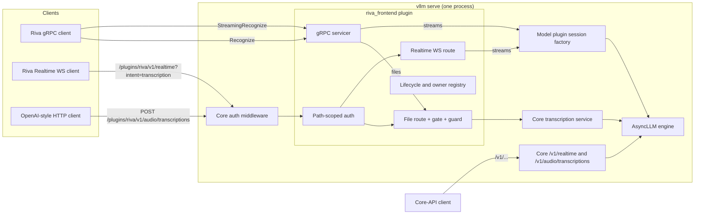

# vllm-riva-frontend on vLLM core: high-level design

## Problem

Clients written for NVIDIA Riva and Speech NIM (Riva gRPC, the Riva Realtime WebSocket, NIM HTTP)
should be able to use an ASR model served by vLLM without changes to the client. This frontend
translates those dialects to vLLM. It ran as an application plugin on vLLM-Omni; this design moves
it onto vLLM core as an endpoint plugin, so that one `vllm serve` process with two installed plugins
(this frontend and a streaming model plugin) serves every surface.

## Approach

1. **An RFC 2 endpoint plugin.** The frontend is one `EndpointPlugin` (`RivaFrontendPlugin`, name
   `riva_frontend`) in the `vllm.endpoint_plugins` group, declaring `required_tasks = ("realtime",)`.
   It serves its HTTP and WebSocket surfaces under its own prefix, `/plugins/riva/v1/`, and
   replaces, shadows or wraps none of core's routes. Core calls its lifecycle methods:
   `attach_router` (the namespaced routes and a path-scoped authentication middleware),
   `init_state` (configuration, model checks, one API server process, the authentication check,
   session factory), `start`
   (the gRPC listener), `ready`, `drain` and `stop`.
2. **Streams through the model's session factory.** Live streams (Riva `StreamingRecognize`, the
   Riva Realtime WebSocket) run on a session factory that the model plugin publishes. The factory
   is discovered by entry point and used through a structural protocol: neither package imports
   the other.
3. **Complete files through core.** Riva `Recognize` and the frontend's
   `POST /plugins/riva/v1/audio/transcriptions` both run on core's transcription service on the
   same server, behind one frontend-owned in-flight file gate and request guard. Core's own
   `POST /v1/audio/transcriptions` and `/v1/realtime` stay core's, outside the frontend's gate.

## Target users

- Operators who run Riva or Speech NIM clients and want vLLM as the server.
- vLLM maintainers reviewing RFC 2, for whom this is a reference consumer of the endpoint plugin
  lifecycle.

## Goals

1. A stock Riva client (`nvidia-riva/python-clients`) streams, recognizes complete files and lists
   models against `vllm serve`, unmodified. The gRPC clients take the server's `host:port`; the
   Realtime WebSocket client takes `host:port/plugins/riva` as its `--server` argument, because it
   builds its URLs by appending `/v1/...` to that argument.
2. The Riva Realtime WebSocket dialect keeps its contract.
3. One server, one engine: no second inference engine, no sidecar.
4. Every task the frontend starts has an owner until it ends. Graceful work is bounded by core's one
   shutdown deadline; after it, the frontend aborts its remaining work and awaits it before `drain`
   returns, so nothing it owns can submit engine work after `drain` or `stop` returns.

## Non-goals

- A Speech NIM HTTP response shape for complete files: clients get core's OpenAI transcription
  response.
- Per-utterance finals on streams (endpointing): deferred, to be designed with the model plugin.
- Serving models other than those whose plugin publishes a session factory.
- Changing vLLM core beyond RFC 1 and RFC 2.
- Replacing, shadowing or guarding core's routes. Core's `/v1/realtime` and
  `POST /v1/audio/transcriptions` keep core's behaviour, outside the frontend's ingress cap, file
  gate and guard. The model plugin refuses beam search and completion limits on core's route once
  core passes those request fields to the model (a pending core change); until then, and to keep
  streams before files, operators do not expose core's file route to untrusted clients.

## Tenets

- **Core's serving services over dialect re-implementation.** Where a core service satisfies a
  surface's contract (complete-file transcription), the frontend routes to it and adapts protocol
  differences at the boundary, accepting dialect changes that do not break that contract (the NIM
  HTTP response becomes OpenAI's shape). It implements only what core lacks (Riva gRPC, the Riva
  Realtime WebSocket framing). The tenet never overrides the stock Riva gRPC contract or the Riva
  Realtime WebSocket contract, which are constraints.
- **Streams before files** (from the model plugin): when stream and file service compete, the
  choice favours streams; the file gate exists for that. The gate covers the frontend's traffic
  (`Recognize` and its file route); files sent to core's own route are outside it.

## System design

Core's authentication middleware checks `--api-key` only on its own prefixes (`/v1`, `/v2`,
`/inference`, `/cohere`). The path-scoped middleware applies the same keys, through core's own
token check, to every HTTP and WebSocket request under `/plugins/riva/` (after `root_path`), with
core's exemption for `OPTIONS`. Core registers its authentication after the plugin hooks, so
`init_state` resolves the tokens from core's installed middleware and fails startup when the two
signals disagree: a key is configured but core's authentication is not installed, or it is
installed but its tokens cannot be read. The class, its `tokens` argument and `verify_token` are
core internals outside RFC 2's supported surface; the frontend pins them with tests. The gRPC
listener is outside `--api-key`, as before. The stock Realtime client sends no `Authorization`
header, so under `--api-key` it needs an intermediary that adds one.

| Component | Role |
| --- | --- |
| Lifecycle (`RivaFrontendPlugin`) | Reads configuration from `--additional-config` (key `riva_frontend`), checks the served model's tasks, resolves the session factory, owns the registry of transport owner tasks, runs `drain` and `stop`, escalates faults |
| gRPC servicer | `StreamingRecognize`, `Recognize`, `GetRivaSpeechRecognitionConfig`, health, reflection, on the frontend's own listener |
| Path-scoped authentication | Middleware added in `attach_router`; applies core's configured `--api-key` tokens, through core's token check, to every HTTP and WebSocket request under `/plugins/riva/`; touches no other path |
| Realtime WebSocket route | `/plugins/riva/v1/realtime`; serves a connection whose query is exactly `intent=transcription` and refuses any other query before accepting the connection, creating no owner or lease |
| File route | `POST /plugins/riva/v1/audio/transcriptions`, added when core serves transcription; applies the ingress cap, file gate and guard, then calls core's transcription service |
| Realtime bootstrap | `POST /plugins/riva/v1/realtime/transcription_sessions`, returning the session defaults the WebSocket dialect echoes |
| Audio frontend | Decode and resample to 16 kHz mono `float32` (μ-law, A-law, PCM16, RIFF/WAV) |
| Error catalog | One mapping from frontend and seam failures to Riva gRPC status codes and NIM WebSocket error codes |
| Operational routes | NIM `health/ready`, `health/live`, `version` and `metadata` under `/plugins/riva/v1/` as HTTP routes; `health/ready` reports the frontend's `ready` predicate |

**Readiness.** Core's `/ready` is this process's aggregate readiness: engine health, every
plugin's `ready` and core's `state.draining`; it needs no token and is the probe for orchestrators.
Core's `/health` keeps its engine-health behaviour and does not read plugin readiness. The
frontend's admission paths read `state.draining` as well as their own state, so they refuse new
owners from the moment core sets it, before or without a `drain` call.

### Session-factory seam

- **Discovery.** Entry-point group `vllm_riva_frontend.session_factories`, owned and documented
  here. `init_state` calls each factory constructor with `(engine_client, engine_client.model_config)`
  unchanged; a constructor returns `None` when it does not serve the model. Exactly one factory must
  accept, unless the configuration names one. A constructor that raises fails startup; that raise is
  the frontend's only engine-capability check.
- **Protocol** (as published by the model plugin's session design): the factory exposes
  `served_cadences`, `locales`, `default_locale` (possibly `None`), `open(cadence, locale)`,
  `drain(deadline) -> list` of cleanup faults (absolute `time.monotonic()` deadline) and
  `teardown_all() -> set` of tasks; a lease exposes `feed`, `update_locale` (returns `None`), `flush`
  (returns the final transcript), `finish`, `abort`, `release` and synchronous `teardown`.
- **Cadence and locale.** Streaming surfaces open at `560ms`; `init_state` fails if the factory does
  not serve it. A stream's locale is the client's, validated against `locales`; when the client
  names none, `default_locale`; when that is `None`, the client must name one.
- **Error contract.** Seam exceptions carry `session_error` (`refused` or `failed`) and `reason`;
  the error catalog maps each reason on its own (for example `locale` is the client's bad input,
  `capacity` and `active_limit` are load, `expired` is an idle stream the engine ended), never all
  refusals to capacity.

### Lifecycle

- **Owners.** The frontend owns one registry of transport owner tasks (one per gRPC stream,
  WebSocket session or file request); the factory owns every engine-facing task of its sessions.
  No detached tasks: a cancelled call settles before abort and release run.
- **Bounded ingress.** A finite ingress cap admits a connection's owner before any configuration or
  audio is read; reads and waits are bounded in time; a client disconnect releases what it held.
  This cap bounds frontend memory and work; the file gate (below) separately bounds files in
  inference.
- **Bounds.** Every lease call runs under a finite frontend bound (configuration, first audio,
  idle, finalization, cleanup). `init_state` reads the engine's stream deadlines (the
  `stream_admission` settings: never-fed, parked-idle and draining) and fails startup unless each
  frontend bound is below the matching engine deadline, so the frontend's bounds are below the engine's
  and the engine's idle abort (`expired`, reported as an idle timeout) is a backstop. The engine
  is the authority for sub-unit traffic and the frontend suspends client-idle timing while a
  lease call is outstanding, so the engine can still end a stream first. During `drain`,
  every bound on graceful work is the remaining time to one absolute deadline. Cleanup calls that
  run after the deadline (an owner's `abort` and `release`) run under the frontend's own cleanup
  bound instead; when one of them expires, the owner tears its lease down synchronously and the
  factory's cleanup of that session is awaited with the rest of the settlement.
- **`drain(state, timeout)`.** Health `NOT_SERVING`; close admission; let owners finish until a
  settle point; then each remaining stream's owner finalizes it (the client gets its final after
  release) or, if that cannot finish, cleans it up as the session design prescribes (abort an open
  lease, never a flushed one, then release), all within the deadline; stop the gRPC server with
  the remaining grace; then `factory.drain(...)`, logging the faults it returns. The settle point
  is a target for graceful work that leaves core time to shut the engine down; core reserves no
  engine allowance, and settlement (below) takes precedence over that target.
- **Settlement.** RFC 2 requires a plugin to settle or abort, and await, all work it owns before
  `drain` returns, raises or is cancelled, and `stop` to settle any background work. So when the
  deadline passes, or `drain` fails or is cancelled, the frontend aborts every remaining owner
  (cancelling its task, which aborts an open lease and releases it) and awaits every owner, every
  task it handed cleanup to, the fault collector (which calls the factory) and the factory's
  cleanup before `drain` ends, so no frontend task can submit engine work while core shuts the
  engine down. The deadline bounds the
  graceful work; the abort-and-await after it is cooperative and has no fixed time limit, as in
  core, whose repeated-signal exit bounds a hang.
- **Startup rollback.** Core calls `stop` only for a plugin whose `start` completed. When
  `init_state` or `start` fails after the factory or a task exists, the frontend tears the factory
  down, cancels what it started, and awaits those tasks before re-raising.
- **`stop(state)`.** Terminal: mark torn down, `factory.teardown_all()`, cancel owners and the
  frontend's own tasks, stop the listener, then await every cancelled task and every task
  `teardown_all` returns until each has ended; it starts no engine work of its own and has no fixed
  time limit.
- **Faults.** A frontend task collects factory cleanup faults while serving (calling the factory's
  `drain` with an immediate deadline, serialized with the shutdown `drain`), and a listener monitor
  watches the gRPC server. An `engine_dead` failure from any call, a collected fault, or an
  unexpected listener exit withdraws readiness and calls `state.request_shutdown()` (an orderly
  restart, not a latch). `drain` ends the collector, and `stop` cancels and awaits the monitor and
  anything still running. `ready` reads attributes only, including `state.draining`, so it reports
  not ready from the moment core begins draining.

### Complete files

- **One gate.** A counting gate of `max_concurrent_files` covers `Recognize` and the frontend's HTTP
  route. It caps the frontend's files in flight; it does not reserve capacity for streams (a
  finished file's slot is held until it retires), and files sent to core's own route are outside
  it and outside the capacity check below. `init_state` fails unless the cap is below both the
  state-slot count and the engine's active-request limit; when that capacity is below 2 and no cap is configured, files are
  disabled with a warning instead (`Recognize` answers `UNIMPLEMENTED`, no `offline` listing, and
  the frontend's route refuses with 501).
- **Guard.** The frontend's route and `Recognize` refuse beam search, completion limits and the
  other fields of the files leaf before taking a gate permit. The model's own refusal of beam search
  and completion limits depends on a pending core change, and the frontend's guard does not depend
  on it.
- **HTTP route.** The frontend's route is `POST /plugins/riva/v1/audio/transcriptions`, beside
  core's `POST /v1/audio/transcriptions`, which it leaves unchanged. After the
  ingress cap admits it, it reads the request body into memory up to a configured bound (larger
  bodies get 413), parses the multipart form in memory with the frontend's bounded parser (no
  filesystem), applies core's upload limit (`VLLM_MAX_AUDIO_CLIP_FILESIZE_MB`) to the file part as
  core's route would, refuses `use_beam_search` and completion limits with 400, takes a gate permit,
  and calls core's transcription service with the audio bytes and a request built with an in-memory
  upload. It returns core's response or event stream as core's route does, keeps core's server-load
  accounting, and on client disconnect cancels the core request and releases the permit. The permit
  is held until the response body has been sent. `init_state` checks that the body bound covers
  core's upload limit. The service is core's internal serving class, which RFC 2 documents as not yet
  a stable contract; the frontend pins it with tests.
- **`Recognize`.** Converts the request's audio to an in-memory 16 kHz mono 16-bit WAV and calls the
  same service through the same gate.
- **Locale.** For `Recognize`, the client's locale is validated against the factory's `locales` and
  sent exactly as `vllm_xargs={"locale": ...}`; `language` carries the locale's language only when
  it is in the model's `supported_languages`, else `None` (also for `auto`). Languages core does not
  know remain reachable this way. The HTTP route keeps core's contract: it forwards the client's
  `language` unchanged, for the model to map, and accepts a client `vllm_xargs` whose only key is
  `locale`. Defaults follow the factory's `default_locale`, on every surface and in the
  realtime bootstrap response; when it is `None`, the client must name a locale.
- **Capability.** `Recognize` and the HTTP route need the model's `transcription` task. Core
  attaches its transcription route only for such a model, so `attach_router` adds the frontend's
  file route only when core's `POST /v1/audio/transcriptions` is present (the frontend serves no
  translation route); without the task, `Recognize` answers
  `UNIMPLEMENTED`. `GetRivaSpeechRecognitionConfig` lists the model once per served locale with
  `type=online` and, when complete files are served, again per locale with `type=offline`; each
  entry names its `language_code` and the encodings and rates it accepts. Unsupported request features are refused explicitly, never ignored.

## Constraints

- **Engine.** vLLM with RFC 1 (persistent-state primitive, stream admission) and RFC 2 (endpoint
  plugin lifecycle: start and stop in vllm#65546, readiness and drain in its follow-up). The
  frontend needs nothing from RFC 1 beyond what the model plugin's session factory provides, so its
  CPU tests run against an RFC 2 build without RFC 1; one check, which pins the frontend's copy of
  the engine's stream-deadline defaults against core, runs in the RFC 1 + RFC 2 build. Serving the
  model needs both. Besides the plugin API, the frontend uses core's transcription service and
  authentication middleware, which are not stable contracts; it pins both with tests. The engine-client protocol does not declare the
  stream-admission calls; the model plugin's factory checks for them.
- **Plugins.** `VLLM_PLUGINS=riva_frontend,nemotron_asr_streaming` (core loads no endpoint plugin
  when the variable is unset), one API server process (the frontend's `init_state` refuses to
  start when the server runs more than one API server process, since every process would bind the
  gRPC port; a count core leaves unset in single-process mode is one), with the model plugin's
  serve flags (float32, eager, synchronous scheduling, no prefix caching, its config format,
  tokenizer mode and lookahead overrides). Experimental native burst is outside the supported
  all-surfaces deployment: the model refuses complete files in that mode.
- **Model contract the frontend relies on.** Tasks exactly `transcription` and `realtime`; complete
  files advance at most one chunk per engine step on their own state slot; the model refuses at
  startup a generation-config token limit or foreign EOS and applies no input-length limit of its
  own, so `--max-model-len` must cover the longest file either frontend file surface admits
  (vehicle leaf, Deployment). The
  frontend's guard covers the per-request limits only. A file's host buffer is freed when the engine reports the request finished, for any reason.
- **Completeness.** A stream's transcript is final only after a normal close. For complete files,
  core's serving returns text for an `error` or `abort` ending, and for a `length` ending at the
  server's `--max-model-len`; an independent core fix will make those failures. Until it lands that
  limitation stands for this model as for every model.
- **Audio never touches the filesystem.** The frontend buffers audio in memory only, within
  configured bounds. Core's own file route is core's and spools large uploads as core does.
- **Public sources.** The Riva and NIM surfaces are defined from public protocol, client and
  documentation sources and our own measurements.

## Intent ownership

This repository owns the frontend's normative intent. Requirements carried over from the earlier
vLLM-Omni frontend keep their `ING-*` IDs when their normative content is unchanged apart from
vocabulary; a changed requirement gets a new ID. The Omni vehicle requirements are replaced by a
new facet for the core vehicle (`ING-EP`); the Speech NIM HTTP requirements are retired with that
module. Every spec ID cited in this repository resolves here or in the model plugin's repository.

## Key design decisions

| Decision | Choice | Alternatives considered and why not |
| --- | --- | --- |
| Integration vehicle | RFC 2 endpoint plugin | vLLM-Omni application plugin: the target is vLLM core; a fork-only seam has no upstream path |
| HTTP and WebSocket paths | Namespaced under `/plugins/riva/v1/`, as vLLM's security guide recommends for endpoint plugins; core's routes untouched | A dispatcher middleware claiming `/v1/realtime?intent=transcription` and an override of core's `POST /v1/audio/transcriptions`: the frontend would change core's own surfaces, and core's routes would depend on which plugins are loaded |
| `--api-key` on the namespace | A path-scoped middleware from `attach_router` that takes core's configured tokens and calls core's token check; startup fails when a key is configured but core's authentication cannot be found | Rely on core: its check covers only `/v1`, `/v2`, `/inference` and `/cohere`, so the namespace would be unauthenticated; a copy of the token check: two implementations of a security check; a FastAPI dependency on each route: covers only routes that declare it, not unknown paths under the prefix, and needs separate WebSocket handling; a change to core's prefixes: outside RFC 1 and RFC 2 |
| Shutdown settlement | Graceful work within the deadline, then abort and await every owned task before `drain` ends; `stop` awaits what it cancels | Return at the deadline with work still cancelling; a fixed wait in `stop`: RFC 2 requires owned work to be settled so that it cannot submit engine requests after the hook returns |
| Complete-file HTTP route | A namespaced route with in-memory parsing, gate and guard, calling core's service | Middleware that buffers and replays the body to core's route: core's form parser spools large uploads to disk and the body is parsed twice; no guard: the model's own refusal depends on a pending core change, and without it beam search and completion limits break the model's single-slot file path |
| `Recognize` | Core's transcription service through the file gate | A stream at a long cadence: a second code path, and the model's file path exists for this |
| Session seam | Entry-point discovery, structural protocol, error attributes read with `getattr` | Importing the model plugin: couples two packages that release separately |
| Fault escalation | `request_shutdown()` on `engine_dead` or a collected cleanup fault | A failure latch: a state that outlives its cause |
| NIM HTTP module | Its response handling is removed and core's service serves complete files; its bounded in-memory multipart parser and limits are kept for the file route | Keep the whole module beside core's route: two implementations of one capability |

## Success metrics

1. CPU: lifecycle, seam conformance (against a fake factory, and against the model plugin's real
   factory), error mapping, `--api-key` coverage of the namespace and the authentication startup
   check, core's routes left unchanged, refusal of a non-transcription WebSocket query, refusal of
   more than one API server process, readiness on core's `/ready` and admission refused while
   `state.draining`, file gate and guard, startup rollback, and settlement of owned work on every
   `drain` and `stop` path (completion, error, cancellation, zero timeout).
2. A40: `nvidia-riva/python-clients` streaming, complete-file and model-listing scripts unmodified;
   the Riva Realtime WebSocket client with `--server host:port/plugins/riva` (with API-key
   authentication disabled, neither `--api-key` nor `VLLM_API_KEY` set, since the stock client
   sends no token); the frontend's
   `POST /plugins/riva/v1/audio/transcriptions`; complete-file
   transcripts equal to the transcript of a factory session at the server's default cadence under
   matched conditions (the same decoded samples,
   with `Recognize`'s PCM16 requantization applied to the stream side too; the same cadence, locale,
   precision and endpointing).
3. Mixed load: Riva streams' p95 final latency with one complete file in flight, submitted through
   `Recognize` or the frontend's file route and with no traffic on core's routes, within 10 % of
   the same run without it.

## References

- RFC 2 endpoint plugins: `docs/design/endpoint_plugins.md` and `vllm/plugins/endpoint_plugins/` on
  `pdtgct/vllm` branches `endpoint-plugin-lifecycle` (vllm#65546) and
  `endpoint-plugin-readiness-drain-review-20261111` (readiness and drain).
- vLLM's endpoint-plugin security guidance: `docs/usage/security.md` (namespaced plugin routes;
  the prefixes `--api-key` covers).
- RFC 1 persistent state: `docs/design/persistent_state.md` on `pdtgct/vllm` branch
  `persistent-state-primitive-v2`.
- Model plugin: `pdtgct/vllm-nemotron-asr-streaming-plugin` (`docs/high-level-design.md`,
  `docs/intent/session/`, `docs/intent/transcription/`).
- Riva protocol and clients: `nvidia-riva/common`, `nvidia-riva/python-clients`.
